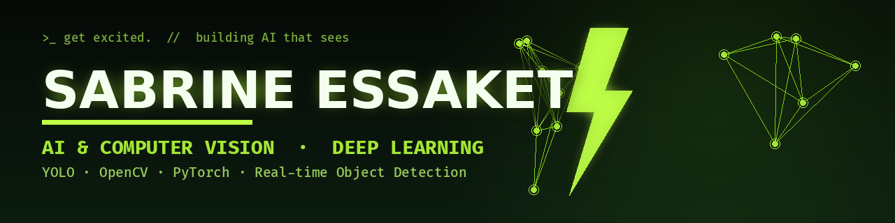
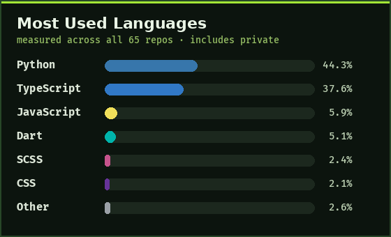

<!-- Profile README for @sabrine0  -->

<!-- ===================== ANIMATED HEADER BANNER ===================== -->
<div align="center">



<!-- ===================== TYPING ANIMATION ===================== -->
<a href="https://git.io/typing-svg">
  
</a>

<!-- ===================== BADGES ===================== -->
<p>
  
  <a href="https://github.com/sabrine0?tab=followers"></a>
  
  
  
</p>

<!-- 🎮 Prominent PLAY button at the top so every visitor sees it -->
<a href="https://sabrine0.github.io/sabrine0/game/" target="_blank" rel="noopener">
  
</a>

<sub>👆 Click to play my <b>Neon Snake</b> game in your browser!</sub>

</div>

<!-- ===================== ABOUT ME ===================== -->
## 👋 About Me

```python
class Sabrine:
    def __init__(self):
        self.name      = "Sabrine Essaket"
        self.role      = "Computer Engineer — AI & Computer Vision"
        self.company   = "Junior Technical Project Manager @ Tomorrow Systems"
        self.based_in  = "Morocco"
        self.education = "Computer Engineering, SupMTI Rabat (Mention Bien, 15.87/20)"
        self.focus     = ["computer vision", "real-time object detection & tracking",
                          "AI for intelligent transportation", "assistive technologies"]
        self.goal      = "Master's scholarship in AI & Computer Vision (2026)"

    def say_hi(self):
        print("Thanks for visiting — let's build something intelligent! 🚀")
```

- 🔭 I build **real-time computer-vision & traffic-management systems** — from YOLO pipelines to full-stack dashboards.
- 👩‍💻 **Junior Technical Project Manager — AI & Software Systems** @ **Tomorrow Systems**, Casablanca.
- 🎓 **Computer Engineer** (Information Systems Engineering), **SupMTI Rabat** — graduated with **Mention Bien (15.87/20)**.
- 🌱 Deepening my research in **object detection & multi-object tracking**, **assistive vision**, and **AI for smart cities**.
- 🎯 **2026 goal:** earning a **Master's scholarship in AI & Computer Vision**.
- 🗣️ Languages: **Arabic** (native) · **French** · **English**
- 📫 Reach me: **sabrineessaket@gmail.com**
- 🎓 **Open to Master's & research opportunities** in AI & Computer Vision

<!-- ===================== RESEARCH INTERESTS ===================== -->
## 🧠 Research Interests

`Computer Vision` · `Real-time Object Detection & Multi-Object Tracking` · `AI for Intelligent Transportation & Traffic Monitoring` · `Assistive Technologies for the Visually Impaired` · `Security of AI-enabled & Embedded Systems`

<!-- ===================== TECH STACK ===================== -->
## 🛠️ Tech Stack

<div align="center">

**AI / Computer Vision**


**Web & Backend**


**Data & DevOps**


**Embedded & Security**


</div>

<!-- ===================== FEATURED PROJECTS ===================== -->
## 🚀 Featured Projects

### 👁️ SEE — Assistive Vision for the Visually Impaired · *2023–2024*
Real-time assistive system that **detects surrounding objects and announces them by voice**.
Built with **YOLOv5s** (PyTorch, OpenCV), confidence filtering and repeated-announcement control, plus
**text-to-speech** feedback. Explored monocular distance estimation and an **ESP32-CAM + Bluetooth** wearable.
`Python` `PyTorch` `OpenCV` `YOLOv5` `TTS` `ESP32-CAM`

### 🚦 Traffic Tracker — Computer-Vision Traffic Analytics · *2026*
**FastAPI** pipeline combining **YOLOv8** detection and **ByteTrack** multi-object tracking for vehicle analytics,
generating **traffic heatmaps** and automated **Excel reports** from video footage.
`FastAPI` `YOLOv8` `ByteTrack` `OpenCV`

### 🏙️ AI Large-Event Visual Intelligence System · *2026*
Detection & counting of **people, vehicles and animals** with **multi-camera, zone-based monitoring**,
incident alerting and decision-support dashboards for large public events.
`Computer Vision` `Multi-camera` `Dashboards`

### 🚥 Smart Traffic Light System — Adaptive Signal Control · *2026*
Connected traffic-management system with **adaptive signal timing**, a traffic simulation and an
**Arduino Mega** hardware prototype, plus operator & police dashboards.
`NestJS` `Next.js` `PostgreSQL` `Docker` `Arduino Mega`

> 💡 More: GMAO/CMMS SaaS platform (.NET), HomeMall housing decision-support (Next.js/Flutter),
> Tasira marketplace, and traffic-controller reverse-engineering tooling (Ghidra, dnSpy).

<!-- ===================== GITHUB STATS ===================== -->
<!-- ===================== PLAYABLE GAME ===================== -->
## 🎮 Play a Game on My Profile!

<div align="center">

Take a break and play my **Neon Snake** game right in your browser — works on desktop & mobile! 🐍

<a href="https://sabrine0.github.io/sabrine0/game/" target="_blank" rel="noopener">
  
</a>

<sub>🕹️ Arrow keys / WASD on desktop · swipe on mobile · beat your high score!</sub>

</div>

## 📊 GitHub Stats

<div align="center">


<br/>

<!-- Accurate languages card measured across ALL repos (incl. private) -->


<br/>


<br/>


<br/>


</div>

<!-- ===================== SNAKE ANIMATION ===================== -->
## 🐍 Watch my contributions get eaten!

<div align="center">

<picture>
  <source media="(prefers-color-scheme: dark)" srcset="https://raw.githubusercontent.com/sabrine0/sabrine0/output/github-contribution-grid-snake-dark.svg" />
  <source media="(prefers-color-scheme: light)" srcset="https://raw.githubusercontent.com/sabrine0/sabrine0/output/github-contribution-grid-snake.svg" />
  
</picture>

</div>

<!-- ===================== FUN: DEV QUOTE ===================== -->
## ✨ Dev Quote of the Day

<div align="center">


</div>

<!-- ===================== CONNECT ===================== -->
## 🤝 Connect With Me

<div align="center">

<a href="mailto:sabrineessaket@gmail.com">
  
</a>
<a href="https://linkedin.com/in/sabrine-essaket">
  
</a>
<a href="https://github.com/sabrine0">
  
</a>
<a href="https://discord.com/users/Zarafa0">
  
</a>

</div>

<!-- ===================== FOOTER ===================== -->
<div align="center">


<i>⭐️ "Building AI that sees — and systems that think." — Sabrine Essaket</i>

</div>
